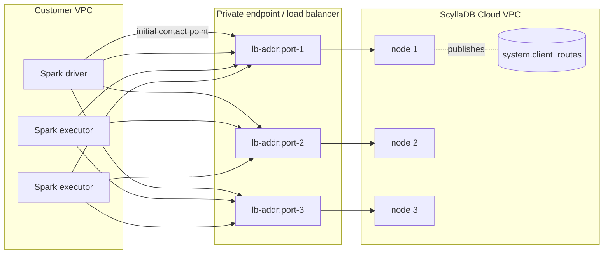

# Design: ScyllaDB Cloud private endpoints (PrivateLink / PSC) in Scylla Migrator and the Spark connector

| | |
|---|---|
| Status | Phase A implemented in scylla-migrator (this branch). Phase B and Phase C proposed. |
| Scope | `scylladb/scylla-migrator`, `scylladb/spark-scylladb-connector` |
| Targets | ScyllaDB Cloud only (AWS PrivateLink, GCP Private Service Connect). No on-prem PrivateLink. |
| Driver | `com.scylladb:java-driver-core` 4.19.2.0 (bundled by connector 4.1.4) |
| Server | ScyllaDB 2026.1+ / ScyllaDB Cloud. CI and probes use `scylladb/scylla:2026.2`. |

## 1. Summary

Some customers reach their ScyllaDB Cloud clusters only through a private endpoint (AWS PrivateLink or
GCP Private Service Connect). Node IP addresses are not routable from the customer VPC; every node is
exposed as a distinct `address:port` pair on a load balancer. ScyllaDB publishes that mapping in the
`system.client_routes` table, keyed by a **connection ID**, and the ScyllaDB Java driver ("client routes"
feature) uses it to rewrite node addresses.

The driver API is ready, but neither the Spark connector nor the migrator exposes it. The plan has three
phases:

- **Phase A: migrator only (implemented).** Bump the connector to 4.1.4 (driver 4.19.2.0) and add a
  migrator-local `CassandraConnectionFactory` that enables client routes, plus a YAML `clientRoutes`
  block, validation, a preflight check and tests. It ships without waiting for a connector release.
- **Phase B: connector upstream.** Make client routes a first-class connector setting (a
  `CassandraConnectorConf` field plus SparkConf keys), wired into `DefaultConnectionFactory`. Fix or
  guard the `localDC` inference bug, and declare the missing POM dependencies. Release as 4.2.0.
- **Phase C: migrator switch-over.** Once connector 4.2.0 is out, replace the migrator-local factory
  with the connector-native setting, keeping the YAML schema unchanged.

## 2. Background

### 2.1 How client routes work



1. ScyllaDB Cloud registers one row per `(connection_id, host_id)` through the node REST API
   (`POST /v2/client-routes` on port 10000). Each row has `connection_id`, `host_id`, `address`, `port`,
   `tls_port`, `alternator_port` and `alternator_https_port`. The table is Raft (group0) managed and
   replicated to every node.
2. The driver connects to the initial contact point, which is one of the private endpoint addresses.
3. The driver reads `system.client_routes`, filtered by the configured connection IDs. Each node then
   gets a `ClientRoutesEndPoint(hostId)` that resolves to the route's `address:port`, or
   `address:tls_port` when SSL is enabled.
4. The driver subscribes to `CLIENT_ROUTES_CHANGE` events and refreshes routes when they change.

A multi-DC cluster usually has **one connection ID per datacenter** (one private endpoint per region),
so a client may need several connection IDs.

### 2.2 Driver API (verified against 4.19.2.0 by compiling and running)

```java
ClientRoutesConfig cfg = ClientRoutesConfig.builder()
    .addEndpoint(new ClientRouteProxy(connectionId, connectionAddrOverrideOrNull))
    .withShardAwareness(false)          // default false
    .build();
CqlSession.builder().withClientRoutesConfig(cfg)...
```

- Added in 4.19.0.7, with important fixes in 4.19.0.9. Connector 4.1.3 bundles 4.19.0.4, which lacks
  the API. Connector 4.1.4 bundles 4.19.2.0, which has it.
- Builder validation:
  - The endpoint list must not be empty, and duplicate connection IDs are rejected.
  - `ClientRouteProxy` rejects a blank ID, and an address override that is blank, contains a port, or
    fails `^[a-zA-Z0-9._:\[\]-]+$`.
- `withTableName` is package-private (`@VisibleForTesting`) and cannot be used.
- `withNativeTransportPort` is only a fallback used to match `TOPOLOGY_CHANGE` events. It is not needed
  on ScyllaDB Cloud.
- `shardAwareness = true` requires the load balancer to forward the client source port (Proxy Protocol
  v2). The HOCON key is spelled `shard-awarness-enabled` (typo in the driver).
- Client routes are mutually exclusive with a user `AddressTranslator`; the driver throws
  `IllegalStateException` if both are set.
- `ClientRoutesConfig` / `ClientRouteProxy` are **not** `java.io.Serializable`. Connector
  configuration must therefore carry plain data and build the driver objects at session creation.
- `OptionsMap`-based configuration does not support client routes. They must be set programmatically
  or in a HOCON file.

### 2.3 Connector facts that shape the design

- `CassandraConnectorConf` is a case class, and its `connectionFactory: CassandraConnectionFactory`
  field is serialized to executors. A case-class factory takes part in the conf's equality, so the
  session cache keys stay distinct (probe S8).
- `DefaultConnectionFactory.connectorConfigBuilder(conf, builder)` is public. It applies pooling,
  timeouts, retry, SSL and the `LocalNodeFirstLoadBalancingPolicy`. A custom factory can reuse it and
  only add `withClientRoutesConfig`.
- `ConfigCheck` rejects unknown `spark.cassandra.*` keys and keys containing `_`, so new SparkConf
  keys must be registered.
- `LocalNodeFirstLoadBalancingPolicy.determineDataCenter` infers the local DC by matching contact
  point **addresses** against node endpoint addresses. Under client routes every node endpoint is a
  `ClientRoutesEndPoint` that resolves to a load-balancer address, so the match fails with
  `assertion failed: There are no contact points in the given set of hosts` (probe S3). An explicit
  `localDC` avoids that code path.
- The published connector POMs (4.1.3 and 4.1.4 alike) do not declare `joda-time` or
  `scala-collection-compat`, although both are needed at runtime; a bare Spark application fails with
  `NoClassDefFoundError`s (probe). This predates 4.1.4. In the migrator, `joda-time` comes from
  `emr-dynamodb-hadoop`, but `scala-collection-compat` is not on `migrator/Runtime/fullClasspath`: the
  integration tests get it from `parquet4s-core` (tests module only), and a Spark cluster has to supply
  it from its own jars. Not verified here against the Spark 4.0.2 distribution.

## 3. Requirements

1. Support ScyllaDB Cloud private endpoints on both the migrator source (`cassandra`/`scylla`) and the
   target (`scylla`).
2. Allow **several connection IDs per cluster** (multi-DC).
3. Keep existing configurations working unchanged. The feature is opt-in.
4. Fail fast with actionable errors for misconfiguration, such as a wrong connection ID or wrong
   `localDC`.
5. Run CI against `scylladb/scylla:2026.2` or newer. Tests must not install anything on, or modify, the
   developer host; everything runs in containers.

## 4. Evidence: live probe (Scylla 2026.2, client isolated behind a TCP proxy)

Topology: 2 DCs × 1 node on an internal Docker network. The client container reaches the nodes only
through a Java TCP proxy container (one port per node) that stands in for the private-endpoint load
balancer. Routes were registered through the REST API.

| # | Scenario | Result |
|---|---|---|
| S1 | Plain driver with client routes | OK. Every node, including the contact node, gets `ClientRoutesEndPoint(hostId)` |
| S2 | Custom connector factory, `localDC=dc1`, both connection IDs | OK. Spark `saveToCassandra` of 1000 rows, then `count = 1000` |
| S3 | Same, without `localDC` | **Fails**: `There are no contact points in the given set of hosts`, so `localDC` is required |
| S4 | Bogus connection ID | **Session opens silently**. Preflight query shows 0 routes and 1 uncovered local node, so a preflight check is needed |
| S5 | Only the local DC's connection ID | OK, including Spark |
| S6 | `connectionAddr` override | Honoured |
| S7 | Route address not resolvable | Fails fast: `DNS resolution failed for host_id=...` |
| S8 | Two confs differing only by factory | Not equal, different hash, so separate sessions |

Not verified yet:

- several nodes in the local DC;
- TLS through `tls_port`;
- Proxy Protocol v2 shard awareness;
- live route changes during a job;
- a real ScyllaDB Cloud private endpoint.

The 3-node variant could not run locally: the Docker VM's `fs.aio-max-nr` limit makes the third Scylla
node crash with `Could not initialize seastar`. The VM sysctl was intentionally left untouched.

---

## 5. Phase A: scylla-migrator (implemented)

### 5.1 User-facing configuration

Same block on `source` (type `cassandra`/`scylla`) and `target` (type `scylla`):

```yaml
target:
  type: scylla
  host: <private-endpoint-address>   # initial contact point only
  port: 9042
  localDC: <datacenter>              # required with clientRoutes
  credentials: { username: <u>, password: <p> }
  clientRoutes:
    endpoints:
      - connectionId: <connection-id-dc1>
      - connectionId: <connection-id-dc2>
        connectionAddr: <vpc-local-alias>   # optional; hostname/IP without port
    shardAwareness: false                    # optional; default false
  keyspace: ks
  table: tbl
  ...
```

Validation happens at config decoding time, so errors are reported before Spark starts:

| Rule | Error |
|---|---|
| `clientRoutes` together with `cloud` | `'clientRoutes' is mutually exclusive with 'cloud'.` |
| `clientRoutes` without `localDC` | `'localDC' is required when 'clientRoutes' is set.` |
| `clientRoutes` without `host`/`port` | existing `'host' and 'port' are required unless 'cloud' is set.` |
| `endpoints: []` | `clientRoutes.endpoints must list at least one connection ID.` |
| blank `connectionId` (after trim) | `clientRoutes.endpoints[i].connectionId must not be empty.` |
| blank `connectionAddr` | `clientRoutes.endpoints[i].connectionAddr must not be empty when set.` |
| duplicate `connectionId` | `clientRoutes.endpoints has duplicate connectionId(s): ...` |
| `connectionAddr` with a port or invalid characters | `clientRoutes.endpoints[i]: <driver message>` (driver `ClientRouteProxy` validation is reused) |

`sslOptions` stays allowed. The driver then uses each route's `tls_port` (not yet verified end to end).

### 5.2 Components

| File | Change |
|---|---|
| `build.sbt` | `connectorVersion` 4.1.3 → 4.1.4 (driver 4.19.2.0). The `tests` module drops `org.apache.cassandra:java-driver-query-builder:4.18.0`: it pulled in Apache `java-driver-core:4.18.0`, whose `com.datastax.oss.driver` classes shadowed the ScyllaDB driver on the test classpath (`NoSuchMethodError` on `withClientRoutesConfig`). The query builder now comes from the connector (`com.scylladb:java-driver-query-builder:4.19.2.0`). The migrator runtime classpath never had the Apache driver. |
| `config/ClientRoutesSettings.scala` (new) | `ClientRoutesSettings(endpoints: List[ClientRouteEndpoint], shardAwareness: Boolean = false)` and `ClientRouteEndpoint(connectionId, connectionAddr: Option[String])`. circe decoder with the validation above; encoder omits an absent `connectionAddr`. `toDriverConfig` builds the driver `ClientRoutesConfig`. |
| `config/SourceSettings.scala`, `config/TargetSettings.scala` | New trailing field `clientRoutes: Option[ClientRoutesSettings] = None`; decoder rules; encoder output. |
| `ClientRoutesConnectionFactory.scala` (new) | `final case class ClientRoutesConnectionFactory(routes) extends CassandraConnectionFactory`. `createSession` requires `IpBasedContactInfo`, reuses `DefaultConnectionFactory.connectorConfigBuilder`, and adds the auth provider, `withClientRoutesConfig(routes.toDriverConfig)`, the connector's application name and `MultiplexingSchemaListener` (parity with `DefaultConnectionFactory`). |
| `ClientRoutesPreflight.scala` (new) | Runs on the Spark driver when a connector is built. It queries `system.client_routes` for the configured IDs and compares the routed host IDs with the metadata nodes of `localDC`. It fails if `localDC` has no nodes (listing the known DCs) or if any local node is uncovered (listing the host IDs); it warns for configured IDs that match no route. Returns a clear error if the table cannot be read (server too old). |
| `Connectors.scala` | `buildSourceConf` / `buildTargetConf` set `connectionFactory = ClientRoutesConnectionFactory(routes)` when configured. `sourceConnector` / `targetConnector` run the preflight. |
| `scylla/ScyllaSparkConnectionOptions.scala` | Rejects `clientRoutes`, because SparkConf options cannot express a custom factory. The helper is only used by tests today. |
| `writers/Scylla.scala` | Version note for `InternalColumns` updated to 4.1.4 (the set is unchanged, still `solr_query`). |
| Docs | `docs/source/configuration.rst` (source and target subsections), `config.yaml.example`. |

Why a custom factory rather than SparkConf keys: connector 4.1.x has no SparkConf key for client
routes, and `OptionsMap` cannot carry them. `CassandraConnectorConf.connectionFactory` is the only
extension point that reaches executor sessions without forking the connector.

Why the preflight is on the driver: the driver opens a session even when no route matches (S4). The
failure would otherwise surface later, as executor connection errors to unreachable node IPs. The
preflight costs one query on a session the job reuses anyway (the connector's session cache).

### 5.3 Tests

Unit tests (no services):

- `config/ClientRoutesConfigTest`: parsing (several IDs, override, trimming, `shardAwareness`), every
  rejection rule, source/target encoder round-trips, and the `toDriverConfig` mapping.
- `ConnectorsTest`:
  - the factory is installed for source and target, and `localDC` and the contact point are kept;
  - the default factory is kept when `clientRoutes` is unset;
  - confs that differ only by routes are unequal;
  - the factory survives Java serialization.
- `ClientRoutesPreflightTest`: covered, uncovered, typo (0 routes), remote-DC-only routes, empty
  `localDC`, and the unused-ID warning.
- `ScyllaSparkConnectionOptionsTest`: a client-routes target is rejected.

Integration test (`scylla/ScyllaClientRoutesTest`, category `Integration`, runs in
`make test-integration-scylla`):

- The `scylla` compose service additionally publishes `127.0.0.1:10000` (REST API, now started with
  `--api-address 0.0.0.0`) and `127.0.0.1:9049 -> 9042`. Port 9049 is the stand-in private endpoint.
  Both are bound to loopback because the REST API has no authentication.
- A suite fixture reads the node `host_id`, registers the route `migrator-it-connection -> 127.0.0.1:9049`
  through `POST /v2/client-routes`, waits for it to appear in `system.client_routes`, and deletes it
  after the suite.
- Tests:
  1. The node endpoint resolves to port 9049, which proves traffic follows the route.
  2. An unknown connection ID fails the preflight.
  3. A full Scylla → Scylla migration (`scylla-to-scylla-client-routes.yaml`) into a target reached
     through client routes.
- Compose files touched: `docker-compose-scylla.yml` (CI), `docker-compose-vnodes-scylla.yml`
  (overlay command), `docker-compose-tests.yml` (local).

Local run, containers only: start `scylla` and `scylla-source` with `SCYLLA_VERSION=2026.2`, then run
sbt inside `eclipse-temurin:17-jdk` with `--network host` (see `.cursor/rules/running-tests.mdc`).
Two things differ from CI on Docker Desktop (macOS):

- Scylla 2026.2 cannot keep its data in the bind-mounted `tests/docker/scylla*` directories: the
  commit log fails an alignment assertion (`commitlog.cc: align_up(p, _alignment) == p`) or segfaults
  at startup. Keep the data inside the container (compose override with `volumes: !reset []`).
- Tablets must be disabled (`--tablets-mode-for-new-keyspaces disabled`, as in
  `docker-compose-vnodes-scylla.yml`, the Makefile default), because `MigratorSuite` creates its
  keyspace with `SimpleStrategy`, which 2026.2 rejects under tablets.

Result with that setup: the full `make test-integration-scylla` scope (CI's service set: `mysql`,
`cassandra`, `gcs`, `scylla-source`, `scylla`) passes, 28 of 28 tests in 13 suites, including the three
`ScyllaClientRoutesTest` tests. All unit tests pass except `DeploySparkClusterScriptTest`, which needs
`python3` in the build container.

### 5.4 Known limitations of Phase A

- `localDC` is mandatory (see §2.3).
- Spark locality: replica preferred locations become load-balancer addresses, which never match an
  executor host. Spark then skips `NODE_LOCAL` and schedules `ANY`. This is the same as with Cloud
  bundles today.
- With `shardAwareness: false` (the default), each connection lands on a random shard. Throughput may
  need a higher `connections` value. Enable `shardAwareness` only once ScyllaDB Cloud confirms Proxy
  Protocol v2 on the endpoint.
- The preflight checks coverage when the job starts. Route changes during a run rely on the driver's
  `CLIENT_ROUTES_CHANGE` handling (not yet verified).

---

## 6. Phase B: spark-scylladb-connector (proposal, to be implemented upstream)

Goal: `spark.cassandra.connection.clientRoutes.*` works for any Spark application (RDD, DataFrame and
SQL APIs, and per-cluster aliases) without a custom factory.

### B1. Configuration model

Add a serializable, driver-independent model next to `CassandraConnectorConf`
(`connector/src/main/scala/com/datastax/spark/connector/cql/`):

```scala
final case class ClientRouteEndpointConf(connectionId: String, connectionAddr: Option[String] = None)

final case class ClientRoutesConf(
  endpoints: Seq[ClientRouteEndpointConf],
  shardAwareness: Boolean = false
) {
  require(endpoints.nonEmpty, "clientRoutes: at least one connection ID is required")

  def toDriver: ClientRoutesConfig =
    endpoints.foldLeft(ClientRoutesConfig.builder()) { (b, e) =>
      b.addEndpoint(new ClientRouteProxy(e.connectionId, e.connectionAddr.orNull))
    }.withShardAwareness(shardAwareness).build()
}
```

Rationale: the driver's `ClientRoutesConfig` is not `Serializable` (§2.2), and the conf must ship to
executors.

### B2. `CassandraConnectorConf` field

- Add `clientRoutes: Option[ClientRoutesConf] = None` as the **last** constructor parameter, with a
  default, so source compatibility is preserved.
- Adding a case-class parameter changes the `apply`/`copy`/`unapply` signatures, which breaks binary
  compatibility. Release it as a **minor** version (4.2.0) and call it out in the release notes.
- Check that the field takes part in `equals`/`hashCode`. The conf is the session cache key, so confs
  that differ only by routes must not share a session (cf. probe S8).

### B3. SparkConf keys

Register them in `CassandraConnectorConf` so that `ConfigCheck` accepts them, per-cluster aliases
(`<cluster>/spark.cassandra...`) are consolidated, and the reference docs are generated:

| Key | Type | Default | Description |
|---|---|---|---|
| `spark.cassandra.connection.clientRoutes.endpoints` | String | none | Comma-separated `connectionId` or `connectionId=connectionAddr` entries. Enables client routes when set. |
| `spark.cassandra.connection.clientRoutes.shardAwareness` | Boolean | `false` | Keep shard awareness through the load balancer (requires Proxy Protocol v2). |

Constraints:

- Keys must be camelCase: `ConfigCheck` rejects `_`.
- Connection IDs containing `,` or `=` cannot be expressed through SparkConf. ScyllaDB Cloud IDs are
  UUID-like, and the programmatic API (B2) remains available for other IDs.
- Parse errors (empty entry, empty ID, duplicate ID, invalid address) must fail in `fromSparkConf`
  with the key name in the message. Reuse `ClientRouteProxy` for address validation.

Example:

```
spark.cassandra.connection.host=<private-endpoint-address>
spark.cassandra.connection.localDC=AWS_US_EAST_1
spark.cassandra.connection.clientRoutes.endpoints=7c0e...-dc1,9a41...-dc2=vpce-alias.internal
```

### B4. `CassandraConnectorConf.fromSparkConf`

1. Parse the keys into `Option[ClientRoutesConf]`.
2. If `clientRoutes` is defined:
   - require `IpBasedContactInfo`. Reject Cloud bundle (`spark.cassandra.connection.config.cloud.path`)
     and profile-file (`spark.cassandra.connection.config.profile.path`) modes with a clear message;
   - require `localDC` (see B6) until `determineDataCenter` is fixed.

### B5. `DefaultConnectionFactory.createSession`

In the `IpBasedContactInfo` branch only:

```scala
case ipConf: IpBasedContactInfo =>
  val b = ipConf.authConf.authProvider.fold(initialBuilder)(initialBuilder.withAuthProvider)
    .withConfigLoader(configLoader)
  conf.clientRoutes.fold(b)(routes => b.withClientRoutesConfig(routes.toDriver))
```

For `CloudBasedContactInfo` and `ProfileFileBasedContactInfo`, throw `IllegalArgumentException` if
`conf.clientRoutes` is defined. This is a defence in depth; B4 already rejects the combination.

No change to `connectorConfigBuilder` is needed: pooling, timeouts, SSL and LBP apply unchanged.

### B6. Local DC inference (`LocalNodeFirstLoadBalancingPolicy`)

Short term (required for 4.2.0): enforce `localDC` when client routes are on (B4).

Follow-up (recommended): make `determineDataCenter` work without `localDC` by matching contact points
by **node identity** instead of address. `metadataManager.getContactPoints` returns `Node` instances.
After the initial refresh those carry `getHostId`/`getDatacenter`, while their endpoints no longer
equal the configured address under client routes. A possible approach:

1. Collect `hostId`s of the contact-point nodes and match `allNodes` by `hostId`.
2. Fall back to the current address match if no host ID is available.

Verify it with the S3 scenario (2 DCs behind a proxy, no `localDC`) before relaxing the B4 check.

Also review `isLocalHost(node)`, which calls `toAddress(node)` for every node on every query plan.
Under client routes, `ClientRoutesEndPoint.resolve()` may involve name resolution, and there is no
"local node" behind a load balancer anyway. Consider short-circuiting `isLocalHost` to `false` for
`ClientRoutesEndPoint`, or caching the result per node. Measure with a multi-node cluster.

### B7. Build and POM hygiene

- Keep the driver at ≥ 4.19.2.0 (it already is in 4.1.4).
- Declare `joda-time:joda-time` and `org.scala-lang.modules:scala-collection-compat` as compile
  dependencies of the connector artifact. Both are used at runtime (closure serialization and
  collection conversions) but missing from the published POMs since at least 4.1.3.

### B8. Tests (connector repo)

Unit:

- SparkConf parsing:
  - single and multiple IDs, `id=addr`, whitespace;
  - empty, duplicate and invalid entries;
  - `ConfigCheck` accepts the new keys and rejects misspelled ones;
  - per-cluster alias consolidation.
- Validation: client routes combined with the Cloud or profile path is rejected; missing `localDC` is
  rejected.
- `CassandraConnectorConf` with and without `clientRoutes`: `equals`/`hashCode` differ; Java
  serialization round-trip.
- `ClientRoutesConf.toDriver` mapping.

Integration (Docker, `scylladb/scylla:2026.2` or newer):

1. **Single node, route to a second published port** (as in the migrator IT): start Scylla with
   `--api-address 0.0.0.0`, publish `9042` and `<routedPort>:9042`, register the route through
   `POST /v2/client-routes`, then assert that the node endpoint resolves to `<routedPort>` and run an
   RDD write/read and a DataFrame write/read with only SparkConf keys.
2. **Multi-DC behind a proxy** (from the probe): 2 DCs × 1 node on an internal network, a TCP proxy
   container with one port per node, and the Spark job in a container attached only to the proxy
   network. Cover:
   - both IDs;
   - only the local ID;
   - a bogus ID (expect a failure once B9 lands, otherwise a failure on first executor access);
   - `connectionAddr` override;
   - no `localDC` (expect the B4 error).

   Note: 3+ Scylla nodes on Docker Desktop may hit the `fs.aio-max-nr` limit; CI Linux runners
   usually allow it.
3. TLS: node with client encryption, route `tls_port` to a published TLS port, and SSL enabled in
   the connector.

### B9. Optional: connector-side preflight

Add an opt-in check equivalent to the migrator's `ClientRoutesPreflight`, for example
`spark.cassandra.connection.clientRoutes.verify=true` (default `false`). It would verify, on the
Spark driver when the connector is first used, that every node of `localDC` has a route. If
accepted, Phase C can drop the migrator's copy.

### B10. Documentation and release

- `doc/reference.md` gets the new keys (generated from `ConfigParameter`s).
- New page "Connecting through ScyllaDB Cloud private endpoints": prerequisites, where to find
  connection IDs, the multi-DC guidance, `localDC` requirement, shard-awareness caveat, and TLS.
- Release 4.2.0 with release notes about the binary-incompatible `CassandraConnectorConf` change.

### B11. Possible zero-code workaround (unverified)

The driver also reads client routes from HOCON (`advanced.client-routes`). Pointing
`spark.cassandra.connection.config.profile.path` at a driver config file that contains contact
points, local DC, auth and client routes might already work with connector 4.1.4. In that mode the
connector ignores every programmatic setting (pooling, auth, SSL, its load-balancing policy), so it
is only a stopgap. Worth a quick test before advertising it.

---

## 7. Phase C: migrator switch-over (after connector 4.2.0)

1. `build.sbt`: `connectorVersion` → 4.2.0.
2. `Connectors.withClientRoutes`: replace
   `conf.copy(connectionFactory = ClientRoutesConnectionFactory(routes))` with
   `conf.copy(clientRoutes = Some(ClientRoutesConf(routes.endpoints.map(e => ClientRouteEndpointConf(e.connectionId, e.connectionAddr)), routes.shardAwareness)))`.
3. Delete `ClientRoutesConnectionFactory.scala` and its tests. Update the `ConnectorsTest` assertions
   to check `conf.clientRoutes`.
4. `ClientRoutesSettings.toDriverConfig`: keep it only for decode-time validation, or delegate
   validation to the connector's parser.
5. `ScyllaSparkConnectionOptions`: drop the `clientRoutes` guard and emit the B3 SparkConf keys from
   `Connectors.sparkSessionOptions`.
6. Keep `ClientRoutesPreflight` unless B9 lands upstream; then switch to the connector option.
7. YAML schema, docs and the integration test stay unchanged. The integration test is the regression
   check for the switch.

---

## 8. Validation plan before GA

| Item | Where | Status |
|---|---|---|
| Unit and integration tests (single node, route to published port) | migrator CI (`scylla:latest`), local with 2026.2 | Passed locally (2026.2); CI pending |
| Multi-node local DC (≥ 3 nodes) through a proxy | connector IT (Linux CI) | Open |
| TLS via `tls_port` | connector IT | Open |
| Proxy Protocol v2 shard awareness | Requires a PPv2-capable proxy (e.g. HAProxy `send-proxy-v2`) | Open |
| Live route change during a job (`CLIENT_ROUTES_CHANGE`) | connector IT: re-POST routes mid-job | Open |
| Real ScyllaDB Cloud private endpoint (AWS PrivateLink and GCP PSC) | Staging cluster, EMR/Dataproc | Open |
| Throughput vs. direct connectivity (shard awareness off) | Staging | Open |

## 9. Open questions

1. Does ScyllaDB Cloud's private endpoint send Proxy Protocol v2? This decides whether
   `shardAwareness: true` can be recommended.
2. Where do customers find connection IDs (console, API), and are they stable across cluster
   operations? The answer shapes the docs.
3. Should the migrator accept a single `connectionId` shorthand in addition to `endpoints`? Not done
   in Phase A, to keep one schema.
4. Should `localDC` default to the datacenter of the connection ID's routes when only one ID is
   given? Not done. An explicit value is safer and matches the connector requirement.

## Appendix A: REST payload used by tests

```json
POST http://<node>:10000/v2/client-routes
[{"connection_id":"migrator-it-connection","host_id":"<uuid>","address":"127.0.0.1",
  "port":9049,"tls_port":9049,"alternator_port":8000,"alternator_https_port":8000}]
```

`DELETE` with the same body removes the entries, and `GET` lists them. The node must be started with
`--api-address 0.0.0.0` for the API to be reachable outside the container.

## Appendix B: Preflight query

```sql
SELECT connection_id, host_id FROM system.client_routes
WHERE connection_id IN ? ALLOW FILTERING
```

Compare the returned `host_id`s with `session.getMetadata.getNodes` filtered by `getDatacenter == localDC`.
