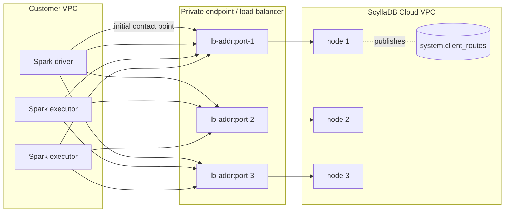

# Design: ScyllaDB Cloud private endpoints (PrivateLink / PSC) in Scylla Migrator and the Spark connector

| | |
|---|---|
| Status | Phase A implemented and reviewed (2026-11-03, §1.1). Phase B implemented on the connector branch `claude/client-routes-privatelink-94291c` (not released). Phase C code done in this branch; the `connectorVersion` bump waits for the release (§7). |
| Scope | `scylladb/scylla-migrator`, `scylladb/spark-scylladb-connector` |
| Targets | ScyllaDB Cloud only (AWS PrivateLink, GCP Private Service Connect). No on-prem PrivateLink. |
| Driver | `com.scylladb:java-driver-core` 4.19.2.0 (bundled by connector 4.1.4) |
| Server | ScyllaDB 2026.1+ / ScyllaDB Cloud. CI and probes use `scylladb/scylla:2026.2`. |

## 1. Summary

Some customers reach their ScyllaDB Cloud clusters only through a private endpoint (AWS PrivateLink or
GCP Private Service Connect). Node IP addresses are not routable from the customer VPC; every node is
exposed as a distinct `address:port` pair on a load balancer. ScyllaDB publishes that mapping in the
`system.client_routes` table, keyed by a **connection ID**, and the ScyllaDB Java driver ("client routes"
feature) uses it to rewrite node addresses.

The driver API is ready, but neither the Spark connector nor the migrator exposes it. The plan has three
phases:

- **Phase A: migrator only (implemented).** Bump the connector to 4.1.4 (driver 4.19.2.0) and add a
  migrator-local `CassandraConnectionFactory` that enables client routes, plus a YAML `clientRoutes`
  block, validation, a preflight check and tests. It ships without waiting for a connector release.
- **Phase B: connector upstream.** Make client routes a first-class connector setting (a
  `CassandraConnectorConf` field plus SparkConf keys), wired into `DefaultConnectionFactory`. Fix or
  guard the `localDC` inference bug, and declare the missing POM dependencies. Release as 4.2.0.
- **Phase C: migrator switch-over.** Once connector 4.2.0 is out, replace the migrator-local factory
  with the connector-native setting, keeping the YAML schema unchanged.

### 1.1 Requirement coverage (review of 2026-11-03)

Requirement: customers who reach their ScyllaDB clusters through AWS PrivateLink or GCP Private
Service Connect must be able to use the migrator, and the Spark connector must support that path.

| Path | Status after Phase A | Closed by |
|---|---|---|
| CQL source (`cassandra`/`scylla`): migration, savepoints, validator | Supported | – |
| CQL target (`scylla`): migration, all source types, validators | Supported | – |
| Any Spark application using the connector (SparkConf keys, DataFrame/SQL API, cluster aliases) | **Not supported**: only reachable through the migrator's custom factory | Phase B |
| TLS through `tls_port` (e.g. GCP "TLS only" connections) | Implemented and checked by the preflight, not verified end to end | §8 |
| Alternator (DynamoDB API) source or target behind a private endpoint | **Basic support** with `loadBalancing: false`: every request goes to the private endpoint, with no per-node routing (§5.4). Client routes for Alternator wait for alternator-client-java#114 | Alternator client, then a migrator option |
| Real ScyllaDB Cloud private endpoint (AWS and GCP) | Not verified | §8 |

Verdict: Phase A resolves the requirement for the migrator's CQL paths. The connector half of the
requirement is resolved only once Phase B ships. Alternator over private connectivity needs
PrivateLink support in the Alternator Java client (scylladb/alternator-client-java#114) for per-node
routing; until then `loadBalancing: false` sends every Alternator request through the private
endpoint.

## 2. Background

### 2.1 How client routes work



1. ScyllaDB Cloud registers one row per `(connection_id, host_id)` through the node REST API
   (`POST /v2/client-routes` on port 10000). Each row has `connection_id`, `host_id`, `address`, `port`,
   `tls_port`, `alternator_port` and `alternator_https_port`. The table is Raft (group0) managed and
   replicated to every node.
2. The driver connects to the initial contact point(s): the private endpoint address(es) and port
   the user provides. A private endpoint's load balancer, deployed per rack or datacenter, has a
   distinct port per node plus one port that reaches all nodes for the initial connection (as
   described in scylladb/alternator-client-java#114). The port is therefore not necessarily 9042.
3. The driver reads `system.client_routes`, filtered by the configured connection IDs. Each node then
   gets a `ClientRoutesEndPoint(hostId)` that resolves to the route's `address:port`, or
   `address:tls_port` when SSL is enabled.
4. The driver subscribes to `CLIENT_ROUTES_CHANGE` events and refreshes routes when they change.

A cluster can have **many connection IDs**: several datacenters, each with several availability
zones, and one connection ID per availability zone. A client therefore lists several IDs even for a
single datacenter, and **together** they must route every node of its local datacenter. The driver
keeps one route per node: when a node is published under several of the configured IDs, the last
usable row it reads wins (`ClientRoutesTopologyMonitor` puts rows into a map keyed by host ID), so
the configuration order does not choose a node's endpoint. The console shows the connection IDs with
the private connection details. On GCP PSC, and on AWS when private DNS
is disabled on the VPC endpoint, the published DNS name does not resolve inside the customer VPC, so
clients pass the endpoint IP address as the connection address override (`connectionAddr`).

### 2.2 Driver API (verified against 4.19.2.0 by compiling and running)

```java
ClientRoutesConfig cfg = ClientRoutesConfig.builder()
    .addEndpoint(new ClientRouteProxy(connectionId, connectionAddrOverrideOrNull))
    .withShardAwareness(false)          // default false
    .build();
CqlSession.builder().withClientRoutesConfig(cfg)...
```

- Added in 4.19.0.7, with important fixes in 4.19.0.9. Connector 4.1.3 bundles 4.19.0.4, which lacks
  the API. Connector 4.1.4 bundles 4.19.2.0, which has it.
- Builder validation:
  - The endpoint list must not be empty, and duplicate connection IDs are rejected.
  - `ClientRouteProxy` rejects a blank ID, and an address override that is blank, contains a port, or
    fails `^[a-zA-Z0-9._:\[\]-]+$`.
- `withTableName` is package-private (`@VisibleForTesting`) and cannot be used.
- `withNativeTransportPort` is only a fallback used to match `TOPOLOGY_CHANGE` events. It is not needed
  on ScyllaDB Cloud.
- `shardAwareness` is about **advanced** shard awareness: the driver binds each connection's source
  port so that it lands on a chosen shard. That needs the load balancer to preserve the client
  source port (Proxy Protocol v2), so it is off by default on the client side for client routes.
  ScyllaDB Cloud private endpoints support it: clients enable it with
  `ClientRoutesConfig.builder()...withShardAwareness(true)` (§9, question 1). **Basic** shard
  awareness is unaffected: the server tells the driver each connection's shard, and the driver sends
  every request to a connection of the shard that owns the data. The HOCON key is spelled
  `shard-awarness-enabled` (typo in the driver).
- **Driver gap (4.19.2.0 and 4.19.2.1):** nothing reads `ClientRoutesConfig.isShardAwarenessEnabled()`.
  Advanced shard awareness is governed only by `advanced.connection.advanced-shard-awareness.enabled`,
  which defaults to `true`, so `withShardAwareness(false)` alone does not turn it off. Behind a proxy
  that rewrites source ports, the pool then logs "New channel ... connected to shard X, but shard Y
  was requested" for mismatched connections and closes the surplus. The migrator therefore also sets
  `advanced-shard-awareness.enabled = false` unless `shardAwareness` is true (found by reading the
  source, not observed at runtime: the integration tests use one shard). Worth reporting to
  `scylladb/java-driver`.
- Client routes are mutually exclusive with a user `AddressTranslator`; the driver throws
  `IllegalStateException` if both are set.
- `ClientRoutesConfig` / `ClientRouteProxy` are **not** `java.io.Serializable`. Connector
  configuration must therefore carry plain data and build the driver objects at session creation.
- `OptionsMap`-based configuration does not support client routes. They must be set programmatically
  or in a HOCON file.
- Resolution happens per node: `ClientRoutesEndPoint.resolve()` looks up the route cached by
  `ClientRoutesTopologyMonitor` and, **when there is none, silently falls back to the node's own
  broadcast address**, which is unreachable behind a private endpoint. A route is also dropped (only
  an error log) when the port column the driver needs is null: `tls_port` when an SSL engine is
  configured, `port` otherwise.
- A server without client routes support rejects the `CLIENT_ROUTES_CHANGE` event registration, and
  the driver fails session creation with "Server does not support CLIENT_ROUTES_CHANGE event
  (requires ScyllaDB Enterprise >= 2026.1)". No client-side version check is needed.

### 2.3 Connector facts that shape the design

- `CassandraConnectorConf` is a case class, and its `connectionFactory: CassandraConnectionFactory`
  field is serialized to executors. A case-class factory takes part in the conf's equality, so the
  session cache keys stay distinct (probe S8).
- `DefaultConnectionFactory.connectorConfigBuilder(conf, builder)` is public. It applies pooling,
  timeouts, retry, SSL and the `LocalNodeFirstLoadBalancingPolicy`. A custom factory can reuse it and
  only add `withClientRoutesConfig`.
- `ConfigCheck` rejects unknown `spark.cassandra.*` keys and keys containing `_`, so new SparkConf
  keys must be registered.
- `LocalNodeFirstLoadBalancingPolicy.determineDataCenter` infers the local DC by matching contact
  point **addresses** against node endpoint addresses. Under client routes every node endpoint is a
  `ClientRoutesEndPoint` that resolves to a load-balancer address, so the match fails with
  `assertion failed: There are no contact points in the given set of hosts` (probe S3). An explicit
  `localDC` avoids that code path. Address matching is fragile here in any case: a PrivateLink DNS
  name resolves to one IP per availability zone, so the contact point and the route address can
  resolve differently.
- The same policy gives every node outside the chosen DC the distance `IGNORED`. The connector
  never opens pools to remote-DC nodes, so only the routes of `localDC` nodes carry traffic; routes of
  other DCs are harmless extras.
- Contact points are separate `DefaultNode` instances (`MetadataManager.addContactPoints`) with no
  host ID, and `InitialNodeListRefresh` matches metadata nodes by host ID only. A fix for the DC
  inference therefore cannot simply compare host IDs of contact points (see B6).
- The published connector POMs (4.1.3 and 4.1.4 alike) do not declare `joda-time` or
  `scala-collection-compat`, although both are needed at runtime; a bare Spark application fails with
  `NoClassDefFoundError`s (probe). This predates 4.1.4. In the migrator, `joda-time` comes from
  `emr-dynamodb-hadoop`, but `scala-collection-compat` is not on `migrator/Runtime/fullClasspath`: the
  integration tests get it from `parquet4s-core` (tests module only), and a Spark cluster has to supply
  it from its own jars. Not verified here against the Spark 4.0.2 distribution.

## 3. Requirements

1. Support ScyllaDB Cloud private endpoints on both the migrator source (`cassandra`/`scylla`) and the
   target (`scylla`).
2. Accept **any number of connection IDs per cluster**: several DCs, several AZs per DC, one
   connection ID per AZ.
3. Keep existing configurations working unchanged. The feature is opt-in.
4. Fail fast with actionable errors for misconfiguration, such as a wrong connection ID or wrong
   `localDC`.
5. Run CI against `scylladb/scylla:2026.2` or newer. Tests must not install anything on, or modify, the
   developer host; everything runs in containers.

## 4. Evidence: live probe (Scylla 2026.2, client isolated behind a TCP proxy)

Topology: 2 DCs × 1 node on an internal Docker network. The client container reaches the nodes only
through a Java TCP proxy container (one port per node) that stands in for the private-endpoint load
balancer. Routes were registered through the REST API.

| # | Scenario | Result |
|---|---|---|
| S1 | Plain driver with client routes | OK. Every node, including the contact node, gets `ClientRoutesEndPoint(hostId)` |
| S2 | Custom connector factory, `localDC=dc1`, both connection IDs | OK. Spark `saveToCassandra` of 1000 rows, then `count = 1000` |
| S3 | Same, without `localDC` | **Fails**: `There are no contact points in the given set of hosts`, so `localDC` is required |
| S4 | Bogus connection ID | **Session opens silently**. Preflight query shows 0 routes and 1 uncovered local node, so a preflight check is needed |
| S5 | Only the local DC's connection ID | OK, including Spark |
| S6 | `connectionAddr` override | Honoured |
| S7 | Route address not resolvable | Fails fast: `DNS resolution failed for host_id=...` |
| S8 | Two confs differing only by factory | Not equal, different hash, so separate sessions |

Not verified yet:

- several nodes in the local DC;
- TLS through `tls_port`;
- Proxy Protocol v2 shard awareness;
- live route changes during a job;
- a real ScyllaDB Cloud private endpoint.

The 3-node variant could not run locally: the Docker VM's `fs.aio-max-nr` limit makes the third Scylla
node crash with `Could not initialize seastar`. The VM sysctl was intentionally left untouched.

---

## 5. Phase A: scylla-migrator (implemented)

### 5.1 User-facing configuration

Same block on `source` (type `cassandra`/`scylla`) and `target` (type `scylla`):

```yaml
target:
  type: scylla
  host: <endpoint-addr-1>,<endpoint-addr-2>:<port-2>   # initial contact points only
  port: <private-endpoint-port>      # user-provided; default for addresses without a port
  localDC: <datacenter>              # required with clientRoutes
  credentials: { username: <u>, password: <p> }
  clientRoutes:
    endpoints:                              # any number of IDs, e.g. one per AZ per DC
      - connectionId: <connection-id-dc1-az1>
      - connectionId: <connection-id-dc1-az2>
      - connectionId: <connection-id-dc2-az1>
        connectionAddr: <vpc-local-alias>   # optional; hostname/IP without port
    shardAwareness: true                     # optional; default false; set true on ScyllaDB Cloud
  keyspace: ks
  table: tbl
  ...
```

Validation happens at config decoding time, so errors are reported before Spark starts:

| Rule | Error |
|---|---|
| `clientRoutes` together with `cloud` | `'clientRoutes' is mutually exclusive with 'cloud'.` |
| `clientRoutes` without `localDC` | `'localDC' is required when 'clientRoutes' is set.` |
| `clientRoutes` without `host`/`port` | existing `'host' and 'port' are required unless 'cloud' is set.` |
| `endpoints: []` | `clientRoutes.endpoints must list at least one connection ID.` |
| blank `connectionId` (after trim) | `clientRoutes.endpoints[i].connectionId must not be empty.` |
| blank `connectionAddr` | `clientRoutes.endpoints[i].connectionAddr must not be empty when set.` |
| duplicate `connectionId` | `clientRoutes.endpoints has duplicate connectionId(s): ...` |
| `connectionAddr` with a port or invalid characters | `clientRoutes.endpoints[i]: <driver message>` (driver `ClientRouteProxy` validation is reused) |

`sslOptions` stays allowed. The driver then uses each route's `tls_port` (not yet verified end to end).

### 5.2 Components

| File | Change |
|---|---|
| `build.sbt` | `connectorVersion` 4.1.3 → 4.1.4 (driver 4.19.2.0). The `tests` module drops `org.apache.cassandra:java-driver-query-builder:4.18.0`: it pulled in Apache `java-driver-core:4.18.0`, whose `com.datastax.oss.driver` classes shadowed the ScyllaDB driver on the test classpath (`NoSuchMethodError` on `withClientRoutesConfig`). The query builder now comes from the connector (`com.scylladb:java-driver-query-builder:4.19.2.0`). The migrator runtime classpath never had the Apache driver. |
| `config/ClientRoutesSettings.scala` (new) | `ClientRoutesSettings(endpoints: List[ClientRouteEndpoint], shardAwareness: Boolean = false)` and `ClientRouteEndpoint(connectionId, connectionAddr: Option[String])`. circe decoder with the validation above; encoder omits an absent `connectionAddr`. `toDriverConfig` builds the driver `ClientRoutesConfig`. |
| `config/SourceSettings.scala`, `config/TargetSettings.scala` | New trailing field `clientRoutes: Option[ClientRoutesSettings] = None`; decoder rules; encoder output. |
| `ClientRoutesConnectionFactory.scala` (new) | `final case class ClientRoutesConnectionFactory(routes) extends CassandraConnectionFactory`. `createSession` requires `IpBasedContactInfo`, reuses `DefaultConnectionFactory.connectorConfigBuilder`, and adds the auth provider, `withClientRoutesConfig(routes.toDriverConfig)`, the connector's application name and `MultiplexingSchemaListener` (parity with `DefaultConnectionFactory`). Unless `shardAwareness` is true, it also sets `advanced.connection.advanced-shard-awareness.enabled = false`, because the driver ignores the client-routes flag (§2.2). |
| `ClientRoutesPreflight.scala` (new) | Runs on the Spark driver when a connector is built. It queries `system.client_routes` (`connection_id`, `host_id`, `port`, `tls_port`) for the configured IDs and compares the host IDs that have a **usable** route with the metadata nodes of `localDC`. A route is usable when it publishes the port the driver will pick: `tls_port` if the session has an SSL engine (`session.getContext.getSslEngineFactory`, the driver's own test), `port` otherwise. It fails if `localDC` has no nodes (listing the known DCs) or if any local node is uncovered (listing the host IDs, and saying whether the connection ID or the port is the problem); it warns for configured IDs that match no route. Servers without client routes never get here: the driver refuses the session (§2.2). |
| `Connectors.scala` | `buildSourceConf` / `buildTargetConf` set `connectionFactory = ClientRoutesConnectionFactory(routes)` when configured. `sourceConnector` / `targetConnector` run the preflight. |
| `scylla/ScyllaSparkConnectionOptions.scala` | Rejects `clientRoutes`, because SparkConf options cannot express a custom factory. The helper is only used by tests today. |
| `writers/Scylla.scala` | Version note for `InternalColumns` updated to 4.1.4 (the set is unchanged, still `solr_query`). |
| Docs | `docs/source/configuration.rst` (source and target subsections), `config.yaml.example`. |

Why a custom factory rather than SparkConf keys: connector 4.1.x has no SparkConf key for client
routes, and `OptionsMap` cannot carry them. `CassandraConnectorConf.connectionFactory` is the only
extension point that reaches executor sessions without forking the connector.

Why the preflight is on the driver: the driver opens a session even when no route matches (S4), and
it drops routes that lack the needed port (§2.2). In both cases the node falls back to its
unreachable IP, and the failure would otherwise surface later as executor connection errors. The
preflight costs one query on a session the job reuses anyway (the connector's session cache).

### 5.3 Tests

Unit tests (no services):

- `config/ClientRoutesConfigTest`: parsing (several IDs, override, trimming, `shardAwareness`), every
  rejection rule, source/target encoder round-trips, and the `toDriverConfig` mapping.
- `ConnectorsTest`:
  - the factory is installed for source and target, and `localDC` and the contact point are kept;
  - the default factory is kept when `clientRoutes` is unset;
  - confs that differ only by routes are unequal;
  - the factory survives Java serialization.
- `ClientRoutesPreflightTest`: covered, uncovered, typo (0 routes), remote-DC-only routes, empty
  `localDC`, the unused-ID warning, and the port rules: with TLS a route without `tls_port` does not
  count, without TLS a missing `tls_port` is irrelevant but a missing `port` is not, and an error
  that mixes both causes names both.
- `ScyllaSparkConnectionOptionsTest`: a client-routes target is rejected.

Integration test (`scylla/ScyllaClientRoutesTest`, category `Integration`, runs in
`make test-integration-scylla`):

- The `scylla` compose service additionally publishes `127.0.0.1:10000` (REST API, now started with
  `--api-address 0.0.0.0`) and `127.0.0.1:9049 -> 9042`. Port 9049 is the stand-in private endpoint.
  Both are bound to loopback because the REST API has no authentication.
- A suite fixture reads the node `host_id`, registers the route `migrator-it-connection -> 127.0.0.1:9049`
  through `POST /v2/client-routes`, waits for it to appear in `system.client_routes`, and deletes it
  after the suite.
- Tests (the programmatic targets use `localhost:9049` as the contact point, as a real deployment
  uses the private endpoint):
  1. The node endpoint resolves to port 9049, which proves traffic follows the route.
  2. An unknown connection ID fails the preflight.
  3. A full Scylla → Scylla migration (`scylla-to-scylla-client-routes.yaml`) into a target reached
     through client routes.
- Compose files touched: `docker-compose-scylla.yml` (CI), `docker-compose-vnodes-scylla.yml`
  (overlay command), `docker-compose-tests.yml` (local).

Local run, containers only: start `scylla` and `scylla-source` with `SCYLLA_VERSION=2026.2`, then run
sbt inside `eclipse-temurin:17-jdk` with `--network host` (see `.cursor/rules/running-tests.mdc`).
Two things differ from CI on Docker Desktop (macOS):

- Scylla 2026.2 cannot keep its data in the bind-mounted `tests/docker/scylla*` directories: the
  commit log fails an alignment assertion (`commitlog.cc: align_up(p, _alignment) == p`) or segfaults
  at startup. Keep the data inside the container (compose override with `volumes: !reset []`).
- Tablets must be disabled (`--tablets-mode-for-new-keyspaces disabled`, as in
  `docker-compose-vnodes-scylla.yml`, the Makefile default), because `MigratorSuite` creates its
  keyspace with `SimpleStrategy`, which 2026.2 rejects under tablets.

Result with that setup: the full `make test-integration-scylla` scope (CI's service set: `mysql`,
`cassandra`, `gcs`, `scylla-source`, `scylla`) passes, 28 of 28 tests in 13 suites, including the three
`ScyllaClientRoutesTest` tests. All unit tests pass except `DeploySparkClusterScriptTest`, which needs
`python3` in the build container.

### 5.4 Known limitations of Phase A

- `localDC` is mandatory (see §2.3).
- Spark locality: replica preferred locations become load-balancer addresses, which never match an
  executor host. Spark then skips `NODE_LOCAL` and schedules `ANY`. This is the same as with Cloud
  bundles today.
- `shardAwareness` defaults to `false`, as in the driver. ScyllaDB Cloud private endpoints support
  advanced shard awareness, so the docs and examples tell ScyllaDB Cloud users to set
  `shardAwareness: true`. With `false`, each connection lands on the shard the server assigns, and
  basic shard awareness still works: the driver knows each connection's shard and sends every
  request to a connection of the shard that owns the data. Keep `false` for a proxy that does not
  preserve the client source port, such as the Docker port forwarding in the integration tests.
- The preflight checks coverage when the job starts. Route changes during a run rely on the driver's
  `CLIENT_ROUTES_CHANGE` handling (not yet verified).
- Contact points (resolved in this branch): the Spark driver and every executor JVM bootstrap their
  own session through the contact points, so a single private endpoint address made session
  creation depend on one endpoint, and the node behind it, being up. `host` now accepts several
  addresses, comma-separated, each optionally `address:port` with `port` as the default
  (`config/ContactPoints.scala`), the same syntax as the connector's
  `spark.cassandra.connection.host`. All of them become contact points (`IpBasedContactInfo.hosts`),
  so users who have several private endpoint addresses (e.g. one per availability zone) list them
  all. The integration test checks that a session opens when the first listed address does not
  answer.
- Alternator (DynamoDB API) is not covered by client routes. The Alternator Java client
  (`com.scylladb.alternator:load-balancing`, from `scylladb/alternator-client-java`; the migrator
  uses 2.0.3) has no client routes or PrivateLink support in any release up to 2.0.6 (GitHub) /
  2.0.7 (Maven Central). It is planned in the open issue scylladb/alternator-client-java#114
  "PrivateLink support" (Jira DRIVER-360, epic DRIVER-54), which has no branch or PR yet (§9,
  question 6). Meanwhile:
  - With `alternatorSettings`, the client discovers nodes through `/localnodes`, which returns node
    addresses that are unreachable behind a private endpoint. On 2.0.3 requests are sent to those
    addresses and fail. Releases 2.0.4 to 2.0.6 make the client fall back instead: scope fallback
    when nodes are unreachable (#84, 2.0.4); node health routing, which admits discovered nodes only
    after a direct `/localnodes` check and keeps failing nodes out of traffic (#136, 2.0.6); and a
    return to the configured contact endpoint, trying each of its DNS addresses (#157, 2.0.6). With
    ≥ 2.0.6, traffic should therefore end up on the configured private endpoint address. Not
    verified.
  - What works with the current client (2.0.3), implemented in this branch: the Alternator settings
    accept `loadBalancing: false` (default `true`) on `type: alternator` sources and targets. The
    migrator then uses the plain AWS SDK client on the Spark driver (`DynamoUtils.buildDynamoClient`)
    and on the executors: `DynamoUtils.setDynamoDBJobConf` still installs
    `AlternatorLoadBalancingEnabler`, which keeps stripping consumed capacity (Alternator rejects
    `ReturnConsumedCapacity: INDEXES`), but tells it to keep the default client. Every request goes to `endpoint`, which should be the private
    endpoint address and its port that reaches all nodes (§2.1), so the load balancer spreads the
    requests. Alternator semantics are kept: `removeConsumedCapacity`, `maxItemsPerBatch`. The
    settings that only the load-balancing client applies (`datacenter`, `rack`, refresh intervals,
    `compression`, `optimizeHeaders`, connection pool settings) are rejected together with
    `loadBalancing: false`. Version 2.0.3 offers nothing else for private endpoints: it cannot turn
    discovery off.
  - Tests: unit tests for the job configuration, the client choice and the config rules, and a
    DynamoDB-to-Alternator migration with `loadBalancing: false` (`BasicMigrationTest`). No real
    private endpoint has been used.
  - Either way there is no per-node routing or key affinity until the client supports client routes
    (#114).

---

## 6. Phase B: spark-scylladb-connector (proposal, to be implemented upstream)

Goal: `spark.cassandra.connection.clientRoutes.*` works for any Spark application (RDD, DataFrame and
SQL APIs, and per-cluster aliases) without a custom factory.

### B0. Baseline (checked 2026-11-03)

- Upstream `scylladb/spark-scylladb-connector` default branch `scylla-4.x` (`c5cccd4e`, after
  `v4.1.4`) already bundles driver 4.19.2.1 and contains no client routes code. Start from upstream
  `scylla-4.x`; the `kendrick-ren` fork's `scylla-4.x` is 52 commits behind it.
- Files to touch: `connector/.../cql/CassandraConnectorConf.scala` (B1–B4),
  `connector/.../cql/CassandraConnectionFactory.scala` (B5, B9),
  `driver/.../cql/LocalNodeFirstLoadBalancingPolicy.scala` (B6), `project/Dependencies.scala` (B7),
  `doc/` (B10).
- `ConfigParameter` instances register themselves in `ConfigParameter.staticParameters`, so new
  parameters declared in the `CassandraConnectorConf` companion are accepted by `ConfigCheck` and
  listed in the generated reference without extra wiring.
- `CassandraConnectorConf.equals`/`hashCode` use `EqualsBuilder`/`HashCodeBuilder` reflection, so a
  new field takes part in session-cache keys automatically (B2).

### B1. Configuration model

Add a serializable, driver-independent model next to `CassandraConnectorConf`
(`connector/src/main/scala/com/datastax/spark/connector/cql/`):

```scala
final case class ClientRouteEndpointConf(connectionId: String, connectionAddr: Option[String] = None)

final case class ClientRoutesConf(
  endpoints: Seq[ClientRouteEndpointConf],
  shardAwareness: Boolean = false
) {
  require(endpoints.nonEmpty, "clientRoutes: at least one connection ID is required")

  def toDriver: ClientRoutesConfig =
    endpoints.foldLeft(ClientRoutesConfig.builder()) { (b, e) =>
      b.addEndpoint(new ClientRouteProxy(e.connectionId, e.connectionAddr.orNull))
    }.withShardAwareness(shardAwareness).build()
}
```

Rationale: the driver's `ClientRoutesConfig` is not `Serializable` (§2.2), and the conf must ship to
executors.

### B2. `CassandraConnectorConf` field

- Add `clientRoutes: Option[ClientRoutesConf] = None` as the **last** constructor parameter, with a
  default, so source compatibility is preserved.
- Adding a case-class parameter changes the `apply`/`copy`/`unapply` signatures, which breaks binary
  compatibility. Release it as a **minor** version (4.2.0) and call it out in the release notes.
- Check that the field takes part in `equals`/`hashCode`. The conf is the session cache key, so confs
  that differ only by routes must not share a session (cf. probe S8).

### B3. SparkConf keys

Register them in `CassandraConnectorConf` so that `ConfigCheck` accepts them, per-cluster aliases
(`<cluster>/spark.cassandra...`) are consolidated, and the reference docs are generated:

| Key | Type | Default | Description |
|---|---|---|---|
| `spark.cassandra.connection.clientRoutes.endpoints` | String | none | Comma-separated `connectionId` or `connectionId=connectionAddr` entries. Enables client routes when set. |
| `spark.cassandra.connection.clientRoutes.shardAwareness` | Boolean | `false` | Advanced shard awareness (shard-targeted source ports) through the load balancer; requires Proxy Protocol v2, which ScyllaDB Cloud private endpoints support (set it to `true` there). Requests reach the right shard either way (basic shard awareness). |

Constraints:

- Keys must be camelCase: `ConfigCheck` rejects `_`.
- Connection IDs containing `,` or `=` cannot be expressed through SparkConf. ScyllaDB Cloud IDs are
  UUID-like, and the programmatic API (B2) remains available for other IDs.
- Parse errors (empty entry, empty ID, duplicate ID, invalid address) must fail in `fromSparkConf`
  with the key name in the message. Reuse `ClientRouteProxy` for address validation.

Example:

```
spark.cassandra.connection.host=<private-endpoint-address>
spark.cassandra.connection.localDC=AWS_US_EAST_1
spark.cassandra.connection.clientRoutes.endpoints=7c0e...-dc1,9a41...-dc2=vpce-alias.internal
```

### B4. `CassandraConnectorConf.fromSparkConf`

1. Parse the keys into `Option[ClientRoutesConf]`.
2. If `clientRoutes` is defined:
   - require `IpBasedContactInfo`. Reject Cloud bundle (`spark.cassandra.connection.config.cloud.path`)
     and profile-file (`spark.cassandra.connection.config.profile.path`) modes with a clear message;
   - require `localDC` (see B6) until `determineDataCenter` is fixed.

### B5. `DefaultConnectionFactory.createSession`

In the `IpBasedContactInfo` branch only:

```scala
case ipConf: IpBasedContactInfo =>
  val b = ipConf.authConf.authProvider.fold(initialBuilder)(initialBuilder.withAuthProvider)
    .withConfigLoader(configLoader)
  conf.clientRoutes.fold(b)(routes => b.withClientRoutesConfig(routes.toDriver))
```

For `CloudBasedContactInfo` and `ProfileFileBasedContactInfo`, throw `IllegalArgumentException` if
`conf.clientRoutes` is defined. This is a defence in depth; B4 already rejects the combination.

Pooling, timeouts, SSL and LBP from `connectorConfigBuilder` apply unchanged. One addition is needed
there: when `conf.clientRoutes` is defined and `shardAwareness` is false, set
`CONNECTION_ADVANCED_SHARD_AWARENESS_ENABLED` to `false`, because the driver ignores
`ClientRoutesConfig.withShardAwareness` (§2.2). Drop this once the driver honours the flag.

### B6. Local DC inference (`LocalNodeFirstLoadBalancingPolicy`)

Short term (required for 4.2.0): enforce `localDC` when client routes are on (B4).

Follow-up (recommended): infer the DC from the **routes** instead of the contact point. Matching
contact points by host ID, as first proposed, does not work: contact points are separate nodes
without a host ID (§2.3). Matching by address is fragile behind a PrivateLink DNS name (§2.3).
A connection ID belongs to one availability zone of one DC, so when a job lists only the IDs of its
own DC (one per AZ), the routed nodes identify that DC:

1. In `LocalNodeFirstLoadBalancingPolicy.init`, when `localDC` is unset and the context's topology
   monitor is a `ClientRoutesTopologyMonitor`, collect the DCs of the nodes that have a route
   (`monitor.resolve(node.getHostId) != null`).
2. Exactly one DC: use it. This covers single-DC clusters and multi-DC clusters where the job lists
   only its own DC's connection IDs.
3. Several DCs: fail with "Client routes cover datacenters X, Y; set
   spark.cassandra.connection.localDC".
4. No client routes: keep the current address match.

This relies on internal driver API, which the policy already uses (`InternalDriverContext`). Pin it
with a unit test so a driver upgrade that changes it fails the build. Verify with the S3 scenario
(2 DCs behind a proxy, no `localDC`) before relaxing the B4 check.

Also short-circuit `isLocalHost(node)` to `false` when `node.getEndPoint` is a
`ClientRoutesEndPoint`. Today it calls `toAddress(node)`, and therefore
`ClientRoutesEndPoint.resolve()` and an `InetAddress` lookup, for every replica on every query plan,
although no executor can be co-located with a node behind a private endpoint. A side effect worth
documenting: every routed node then has distance `REMOTE`, so the pool size comes from
`remoteConnectionsPerExecutor` (default 1). This is already the case for any deployment whose
executors do not run on the database nodes.

### B7. Build and POM hygiene

- Keep the driver at ≥ 4.19.2.0 (it already is in 4.1.4).
- Declare `joda-time:joda-time` and `org.scala-lang.modules:scala-collection-compat` as compile
  dependencies of the connector artifact. Both are used at runtime (closure serialization and
  collection conversions) but missing from the published POMs since at least 4.1.3.

### B8. Tests (connector repo)

Unit:

- SparkConf parsing:
  - single and multiple IDs, `id=addr`, whitespace;
  - empty, duplicate and invalid entries;
  - `ConfigCheck` accepts the new keys and rejects misspelled ones;
  - per-cluster alias consolidation.
- Validation: client routes combined with the Cloud or profile path is rejected; missing `localDC` is
  rejected.
- `CassandraConnectorConf` with and without `clientRoutes`: `equals`/`hashCode` differ; Java
  serialization round-trip.
- `ClientRoutesConf.toDriver` mapping.

Integration (Docker, `scylladb/scylla:2026.2` or newer):

1. **Single node, route to a second published port** (as in the migrator IT): start Scylla with
   `--api-address 0.0.0.0`, publish `9042` and `<routedPort>:9042`, register the route through
   `POST /v2/client-routes`, then assert that the node endpoint resolves to `<routedPort>` and run an
   RDD write/read and a DataFrame write/read with only SparkConf keys.
2. **Multi-DC behind a proxy** (from the probe): 2 DCs × 1 node on an internal network, a TCP proxy
   container with one port per node, and the Spark job in a container attached only to the proxy
   network. Cover:
   - both IDs;
   - only the local ID;
   - a bogus ID (expect the B9 error; without B9, connections to the unroutable node IPs fail);
   - `connectionAddr` override;
   - no `localDC` (expect the B4 error).

   Note: 3+ Scylla nodes on Docker Desktop may hit the `fs.aio-max-nr` limit; CI Linux runners
   usually allow it.
3. TLS: node with client encryption, route `tls_port` to a published TLS port, and SSL enabled in
   the connector. Add a negative case: a route registered without a usable `tls_port` must fail the
   B9 check.

### B9. Connector-side route verification (recommended)

Port the migrator's `ClientRoutesPreflight` to the connector so that every Spark application gets
it, not only the migrator. The driver never fails on a missing or unusable route. It falls back to
the node's own address (§2.2), so without this check a typo in a connection ID or a missing
`tls_port` shows up as connection timeouts on executors.

- Key: `spark.cassandra.connection.clientRoutes.verify`, Boolean, default **`true`**.
- Where: at the end of `DefaultConnectionFactory.createSession`, when `conf.clientRoutes` is defined
  and the code runs on the Spark driver (`SparkEnv.get == null` or
  `SparkEnv.get.executorId == SparkContext.DRIVER_IDENTIFIER`). Executors skip it, because the
  driver already checked the same conf.
- What: query `connection_id, host_id, port, tls_port` from `system.client_routes` for the
  configured IDs. Fail session creation (close the session, throw `IllegalStateException`) when a
  node of the local DC has no route with the port the driver will use: `tls_port` if
  `session.getContext.getSslEngineFactory.isPresent`, `port` otherwise. Warn about connection IDs
  without any route.
- The migrator's `ClientRoutesPreflight.evaluate` is pure and unit-tested, so it can move as is.
  Phase C then deletes the migrator's copy.

### B10. Documentation and release

- `doc/reference.md` gets the new keys (generated from `ConfigParameter`s).
- New page "Connecting through ScyllaDB Cloud private endpoints": prerequisites, where to find
  connection IDs, the multi-DC guidance, `localDC` requirement, shard-awareness caveat, and TLS.
- Release 4.2.0 with release notes about the binary-incompatible `CassandraConnectorConf` change.

### B11. Possible zero-code workaround (unverified)

The driver also reads client routes from HOCON (`advanced.client-routes`). Pointing
`spark.cassandra.connection.config.profile.path` at a driver config file that contains contact
points, local DC, auth and client routes might already work with connector 4.1.4. In that mode the
connector ignores every programmatic setting (pooling, auth, SSL, its load-balancing policy), so it
is only a stopgap. Worth a quick test before advertising it.

### B12. Delivery plan

Each step is one upstream pull request against `scylla-4.x`. Steps 1 and 2 are independent and can go
in parallel; step 3 needs step 1.

| # | Pull request | Contents | Done when |
|---|---|---|---|
| 1 | POM hygiene | B7 | A bare Spark app with only the connector on the classpath (no `parquet4s`, no EMR jars) runs an RDD read without `NoClassDefFoundError`. |
| 2 | Client routes configuration | B1–B5, B8 unit tests, IT 1 (single node, routed port) | An RDD and a DataFrame write/read with **only SparkConf keys** go through the routed port; confs with and without routes do not share a session; Cloud/profile + routes and routes without `localDC` fail in `fromSparkConf` with the key name. |
| 3 | Route verification | B9, its unit tests, the negative cases of IT 2 and IT 3 | A bogus connection ID and a missing `tls_port` fail on the Spark driver before any task runs. |
| 4 | Load-balancing policy | B6 follow-up (DC inference, `isLocalHost` short-circuit), IT 2 without `localDC` | S3 passes without `localDC` when one DC is routed and fails with the B6 message when two are. Relax the B4 `localDC` rule in this PR. |
| 5 | Docs and release 4.2.0 | B10 | Reference regenerated; private-endpoint page published; release notes call out the `CassandraConnectorConf` binary change. |

The multi-DC proxy IT (IT 2) needs Linux CI runners. The single-node IT (IT 1) also runs on Docker
Desktop. Then Phase C (§7) moves the migrator to 4.2.0.

---

## 7. Phase C: migrator switch-over (code done, waiting for the connector release)

Status: the code changes are in the working tree of this branch. Only step 1 is left, and it
waits for the connector release that contains Phase B. Until then the branch does **not** compile
against connector 4.1.4 (it uses `CassandraConnectorConf.clientRoutes`). It was built and tested
against a local snapshot of the Phase B branch, published with `publishLocal` and forced with
`dependencyOverrides`.

1. **Pending:** `build.sbt`: `connectorVersion` → the release that contains Phase B (4.1.5 or 4.2.0).
2. Done: `Connectors.withClientRoutes` sets `conf.clientRoutes = Some(routes.toConnectorConf)` and
   keeps `DefaultConnectionFactory`.
3. Done: deleted `ClientRoutesConnectionFactory.scala`, `ClientRoutesPreflight.scala` and
   `ClientRoutesPreflightTest`. The connector's `ClientRoutesVerifier` does the same check (B9,
   default on) when the Spark driver opens its first session, which the readers, writers and
   validators all do before scheduling tasks. `sourceConnector`/`targetConnector` are plain
   `new CassandraConnector(conf)` again. `ConnectorsTest` checks `conf.clientRoutes`, the advanced
   shard awareness setting produced by `DefaultConnectionFactory.connectorConfigBuilder`, and that a
   conf with routes survives Java serialization.
4. Done: `ClientRoutesSettings.toDriverConfig` became `toConnectorConf`. The migrator keeps its own
   decode-time validation, whose messages name the YAML fields; the connector's
   `ClientRoutesConf.validate` is `private[cql]`, and its constructor validates again.
5. Done: `ScyllaSparkConnectionOptions` no longer rejects client routes. `Connectors.sparkSessionOptions`
   emits `spark.cassandra.connection.clientRoutes.endpoints` (`id[=addr],...`) and `.shardAwareness`.
   Connection IDs that contain `,` or `=` cannot be expressed that way and are rejected with a clear
   error. A test checks that the connector parses the emitted options back into the same routes.
6. Done: `localDC` is no longer required with `clientRoutes`. The connector infers it from the
   routed nodes (B6) and fails with "Client routes cover datacenters X, Y; set
   spark.cassandra.connection.localDC" when they span several. Docs updated.
7. Integration test changes:
   - an unknown connection ID now fails when the session opens, as the connector's `IOException`
     ("Failed to open native connection ... :: Client routes: ... have no usable client route ...")
     rather than as an `IllegalStateException` from `targetConnector`;
   - new case: without `localDC`, the policy uses the routed nodes' datacenter.
   The YAML schema is otherwise unchanged.

---

## 8. Validation plan before GA

| Item | Where | Status |
|---|---|---|
| Unit and integration tests (single node, route to published port) | migrator CI (`scylla:latest`), local with 2026.2 | Passed locally (2026.2, re-run 2026-11-03 after the preflight port check: 3/3 IT, all client routes unit tests); CI pending |
| Multi-node local DC (≥ 3 nodes) through a proxy | connector IT (Linux CI) | Open |
| TLS via `tls_port` | connector IT | Open. The preflight rule is unit-tested only |
| Alternator through a private endpoint | Alternator Java client (alternator-client-java#114); interim fallback with ≥ 2.0.6 to be verified | Open, not in scope of Phases A–C |
| Advanced shard awareness with `shardAwareness: true`: connections land on the requested shards, with no "connected to shard X, but shard Y was requested" warnings | Real ScyllaDB Cloud private endpoint, or a PPv2-capable proxy (e.g. HAProxy `send-proxy-v2`) in an IT | Open |
| Live route change during a job (`CLIENT_ROUTES_CHANGE`) | connector IT: re-POST routes mid-job | Open |
| Real ScyllaDB Cloud private endpoint (AWS PrivateLink and GCP PSC) | Staging cluster, EMR/Dataproc | Open |
| Throughput vs. direct connectivity (advanced shard awareness off) | Staging | Open |
| Advanced shard awareness really off under client routes (no "connected to shard X, but shard Y was requested" warnings with `--smp` > 1 behind a port-rewriting proxy) | Migrator or connector IT with a multi-shard node | Open: config checked by tests, behaviour not observed |

## 9. Open questions

1. Resolved: ScyllaDB Cloud private endpoints support advanced shard awareness, but it is off by
   default on the client side, so clients enable it in the driver config:

   ```java
   ClientRoutesConfig config = ClientRoutesConfig.builder()
       .addEndpoint(new ClientRouteProxy("12345678-1234-1234-1234-123456789012"))
       .withShardAwareness(true)
       .build();
   CqlSession session = CqlSession.builder()
       .addContactPoint(InetSocketAddress.createUnresolved("my-cluster-endpoint.example.com", 9042))
       .withClientRoutesConfig(config)
       .withLocalDatacenter("datacenter1")
       .build();
   ```

   The migrator's `clientRoutes.shardAwareness: true` (and the connector's
   `spark.cassandra.connection.clientRoutes.shardAwareness=true`) maps to `withShardAwareness(true)`
   and leaves the driver's `advanced-shard-awareness.enabled` at its default (`true`). The default
   stays `false`, as in the driver; the docs tell ScyllaDB Cloud users to enable it. Note the driver
   gap in §2.2: in 4.19.2.x, `withShardAwareness(false)` alone does not turn advanced shard awareness
   off, which is why the migrator and the connector also set `advanced-shard-awareness.enabled`
   to `false` in that case.
2. Resolved: users provide the connection IDs (shown in the console with each private connection;
   one per availability zone of each datacenter). The migrator and the connector do not read them
   through the Cloud API.
3. Resolved: no single-`connectionId` shorthand. A target can span several DCs with several AZs
   each, and one connection ID per AZ, so `endpoints` stays a list of any length. The preflight
   (and B9) check that the listed IDs together route every node of `localDC`.
4. Resolved: `localDC` defaults to the datacenter of the routed nodes when the listed connection
   IDs route a single datacenter (connector B6, inherited by the migrator in Phase C).
5. Resolved: the user provides the private endpoint address(es) and port. The port is the one of
   the private endpoint, not necessarily 9042 (the usual port without client routes) or 9000. When
   several endpoint addresses are provided, all of them are used as contact points (§5.4).
6. Answered from the `scylladb/alternator-client-java` releases and issues (checked 2026-11-04):
   - No release (2.0.0 to 2.0.6 on GitHub, 2.0.7 on Maven Central) supports client routes,
     PrivateLink or Private Service Connect.
   - The work is tracked in scylladb/alternator-client-java#114 "PrivateLink support" (Jira
     DRIVER-360, epic DRIVER-54, migrated from scylladb/alternator-load-balancing#161). It is open,
     unassigned and has no PR. Its proposed configuration is a list of
     `{cloud_connection_id, endpoint}` plus a `discoveryPort`, mirroring the CQL client routes.
   - Interim behaviour and what the migrator can do now are in §5.4.

   Migrator follow-ups:
   1. Raise `com.scylladb.alternator:load-balancing` from 2.0.3 to ≥ 2.0.6, to get the fallbacks of
      #84, #136 and #157. Separate change: it affects every Alternator migration. The 2.0.5 rename
      of the response compression builder API does not touch the migrator, which only sets request
      compression.
   2. Done in this branch: `loadBalancing: false`, and documentation that for Alternator behind a
      private endpoint, `endpoint` is the private endpoint address and its port that reaches all
      nodes (§5.4).
   3. Once #114 ships, add the Alternator equivalent of `clientRoutes` (connection IDs and endpoint)
      to the migrator's Alternator settings.

## Appendix A: REST payload used by tests

```json
POST http://<node>:10000/v2/client-routes
[{"connection_id":"migrator-it-connection","host_id":"<uuid>","address":"127.0.0.1",
  "port":9049,"tls_port":9049,"alternator_port":8000,"alternator_https_port":8000}]
```

`DELETE` with the same body removes the entries, and `GET` lists them. The node must be started with
`--api-address 0.0.0.0` for the API to be reachable outside the container.

## Appendix B: Preflight query

```sql
SELECT connection_id, host_id, port, tls_port FROM system.client_routes
WHERE connection_id IN ? ALLOW FILTERING
```

Keep the rows that have the port the driver will use (`tls_port` when
`session.getContext.getSslEngineFactory.isPresent`, `port` otherwise), then compare their
`host_id`s with `session.getMetadata.getNodes` filtered by `getDatacenter == localDC`.
